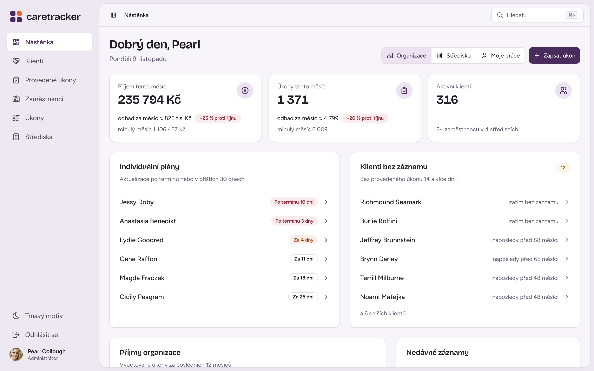
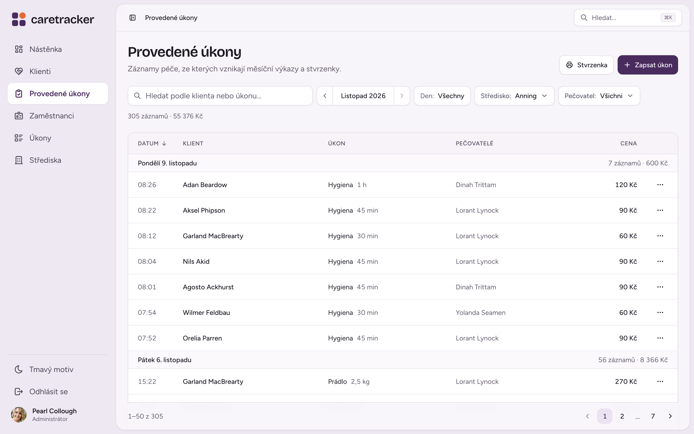
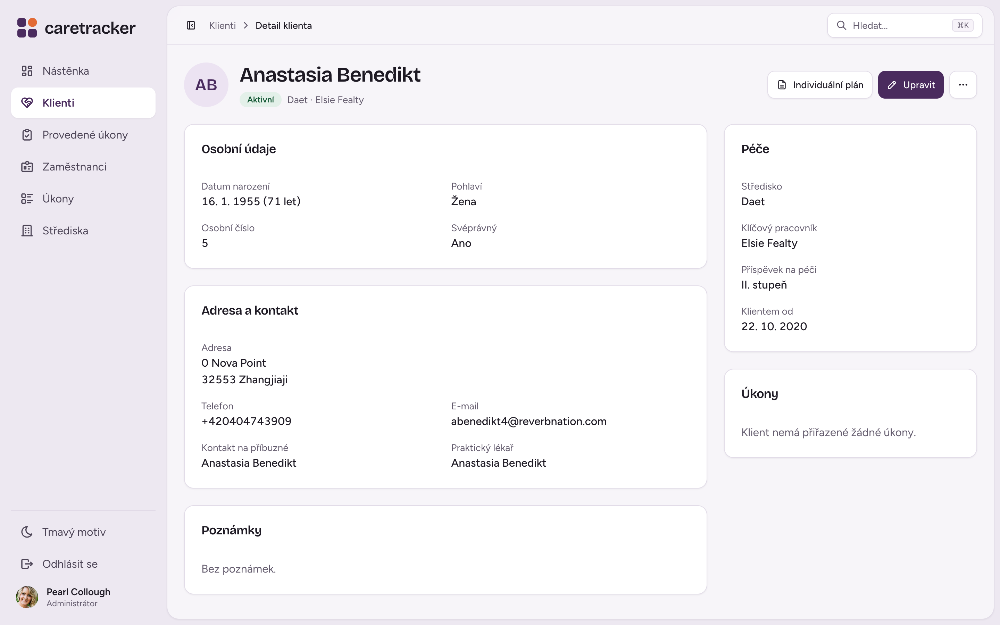
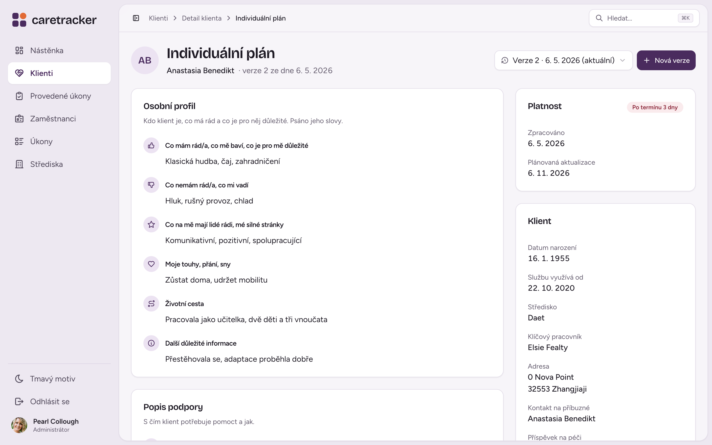
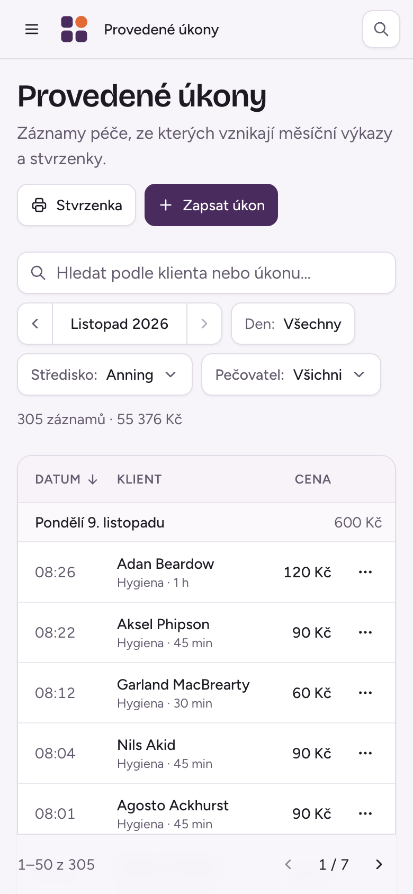

<div align="center">
  <picture>
    <source media="(prefers-color-scheme: dark)" srcset=".github/assets/logo-dark.svg" />
    
  </picture>

  <p><strong>Care records, monthly reports and billing for home care services – in one place, without paper.</strong></p>

  <p>
    <a href="https://demo.caretracker.cz"></a>
  </p>

  <p>
    <a href="https://github.com/michroucka/CareTracker/actions/workflows/deploy-demo.yml"></a>
    
    
    
    
    
    
    
  </p>

  <p>
    <a href="#features">Features</a> ·
    <a href="#screenshots">Screenshots</a> ·
    <a href="#quick-start">Quick start</a> ·
    <a href="#tech-stack">Tech stack</a> ·
    <a href="#documentation">Documentation</a> ·
    <a href="README.md">Česky</a>
  </p>
</div>

> [!NOTE]
> CareTracker targets Czech home care providers, so the user interface is in Czech only. This README describes the project for an international audience.

---

CareTracker replaces paper timesheets and spreadsheets in home care services. Caregivers log their visits from a phone, coordinators keep track of clients and department workload, and clients review their own monthly statement and pay it with a QR code. It started as a bachelor's thesis and keeps evolving.

## Features

| | |
|---|---|
| **Care logging** | Performed tasks grouped by day, with time, quantity and price. Quick entry, editing and a full monthly overview. |
| **Clients** | Personal details, profile photo, care allowance level, assigned caregivers, end of care and location on a map. |
| **Individual care plans** | Versioned care plans with daily records for each client. |
| **Dashboard** | A monthly overview per role – revenue, caregiver workload, clients without a recent visit and plans due for review. |
| **Reports and receipts** | Monthly reports and receipts as PDF, data export by client and period. |
| **Client billing** | Clients see their statement and pay with a QR code. |
| **Organizations and departments** | Multiple organizations in one installation (organization → department → employee) with matching access restrictions. |
| **Roles and permissions** | Superadmin, admin, coordinator, caregiver and client – enforced on both the backend and the frontend. |
| **Built for field work** | Responsive layout for phones, light and dark mode, quick search (<kbd>Ctrl</kbd> <kbd>K</kbd> / <kbd>⌘</kbd> <kbd>K</kbd>). |

## Screenshots



<table>
  <tr>
    <td width="50%"></td>
    <td width="50%"></td>
  </tr>
  <tr>
    <td align="center"><sub>Performed tasks by day</sub></td>
    <td align="center"><sub>Client detail</sub></td>
  </tr>
  <tr>
    <td width="50%"></td>
    <td width="50%" align="center"></td>
  </tr>
  <tr>
    <td align="center"><sub>Individual care plan</sub></td>
    <td align="center"><sub>On a phone</sub></td>
  </tr>
</table>

> The quickest way to try it is the [live demo](https://demo.caretracker.cz).

## Quick start

**You need:** [Docker](https://www.docker.com/) with Docker Compose and `make` (optional, but it keeps the commands short).

```bash
git clone git@github.com:michroucka/CareTracker.git
cd CareTracker

cp .env.example .env
# set POSTGRES_USER / POSTGRES_PASSWORD / POSTGRES_DB in .env;
# e-mail and the Mapy.com key go into backend/src/main/resources/secrets.properties

make up
```

| Service | Address |
|---|---|
| Frontend | <http://localhost:3000> |
| Backend API | <http://localhost:8080> |
| PostgreSQL | `localhost:5432` |

<details>
<summary><strong>Useful commands</strong></summary>

```bash
make down                  # stop all services
make restart-backend       # restart the backend
make compile               # recompile the backend (DevTools restarts the app)
make rebuild s=backend     # rebuild the image and restart a service (after a Dockerfile change)
make clean                 # remove volumes and rebuild everything (resets the database)
make logs service=backend  # follow a service's logs
make seed-activity         # fill in demo activity up to today
make test                  # backend and frontend tests
```

See the [`Makefile`](Makefile) for all commands.

</details>

## Tech stack

<table>
  <tr>
    <th align="left">Frontend</th>
    <td>
      <a href="https://react.dev/">React 19</a> + <a href="https://vite.dev/">Vite</a>,
      <a href="https://tailwindcss.com/">Tailwind CSS 4</a>,
      <a href="https://ui.shadcn.com/">shadcn/ui</a> on <a href="https://www.radix-ui.com/">Radix UI</a>,
      <a href="https://reactrouter.com/">React Router</a>,
      <a href="https://recharts.org/">Recharts</a>,
      <a href="https://maplibre.org/">MapLibre</a> with <a href="https://developer.mapy.com/">Mapy.com</a> tiles,
      <a href="https://motion.dev/">Motion</a>,
      <a href="https://tabler.io/icons">Tabler Icons</a>
    </td>
  </tr>
  <tr>
    <th align="left">Backend</th>
    <td>
      <a href="https://spring.io/projects/spring-boot">Spring Boot 3</a> (Java 21),
      <a href="https://spring.io/projects/spring-security">Spring Security</a> (sessions),
      <a href="https://spring.io/projects/spring-data-jpa">Spring Data JPA</a>,
      <a href="https://github.com/flyingsaucerproject/flyingsaucer">Flying Saucer</a> (PDF),
      <a href="https://docs.spring.io/spring-framework/reference/integration/email.html">Spring Mail</a> + <a href="https://www.thymeleaf.org/">Thymeleaf</a>
    </td>
  </tr>
  <tr>
    <th align="left">Database</th>
    <td><a href="https://www.postgresql.org/">PostgreSQL 15</a>, migrations with <a href="https://flywaydb.org/">Flyway</a></td>
  </tr>
  <tr>
    <th align="left">Testing</th>
    <td>
      <a href="https://junit.org/">JUnit 5</a>, <a href="https://site.mockito.org/">Mockito</a>,
      Spring Boot Test (<code>@WebMvcTest</code>), Spring Security Test,
      <a href="https://vitest.dev/">Vitest</a>
    </td>
  </tr>
  <tr>
    <th align="left">Deployment</th>
    <td><a href="https://www.docker.com/">Docker Compose</a>; the demo deploys automatically from <code>main</code> via GitHub Actions</td>
  </tr>
</table>

## Roles

```
SUPERADMIN > ADMIN > COORDINATOR > CAREGIVER
CLIENT (separate role, sees only their own data)
```

Permissions are enforced by the backend (`@PreAuthorize`) and the frontend (protected routes and role-based filters).

## Project structure

```
backend/         Spring Boot – REST API, business logic, database migrations
frontend/        React + Vite – user interface
doc/             bachelor's thesis, specification, ER and use-case diagrams
docs/branding/   visual identity – logo, colors, typography, redesign plan
```

## Documentation

- [Bachelor's thesis](doc/bachelors_thesis.pdf) (Czech) – analysis, design and user documentation
- [Software specification](doc/software_specification.pdf)
- [ER diagram](doc/ERA_Model.pdf) · [Use-case diagram](doc/UC_Diagram.png)
- [Visual identity](docs/branding/brand-board.html) and [redesign plan](docs/branding/PLAN.md) (Czech)

## License

All rights reserved. The source code is published for viewing and study purposes only; copying, modifying or commercial use without the author's permission is not allowed. See [`LICENSE`](LICENSE).
