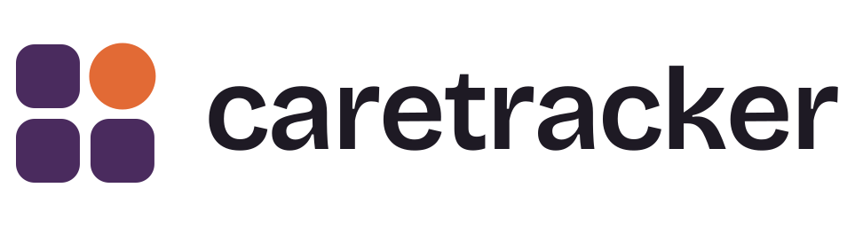
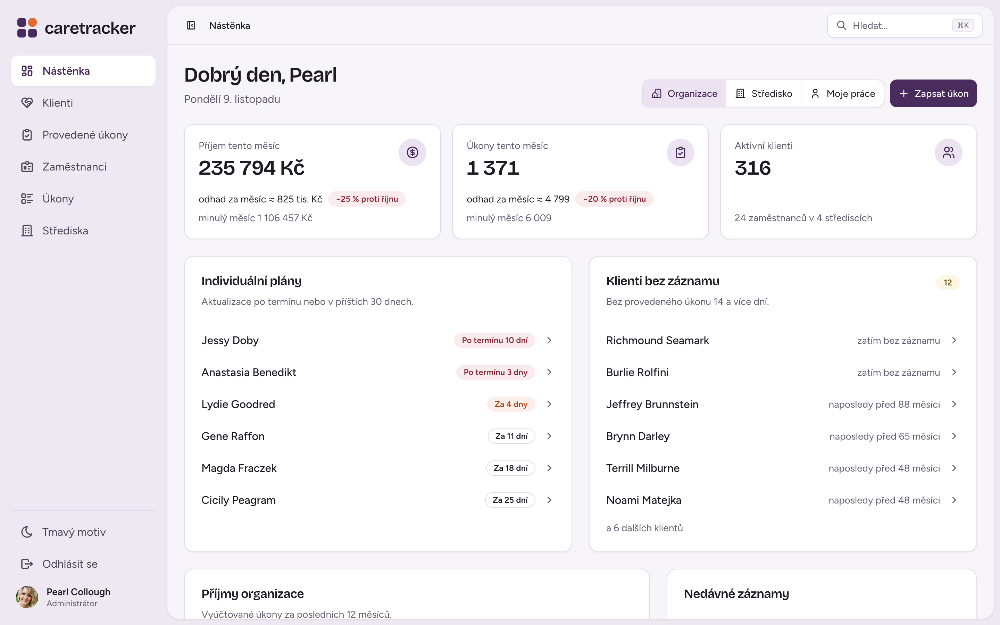
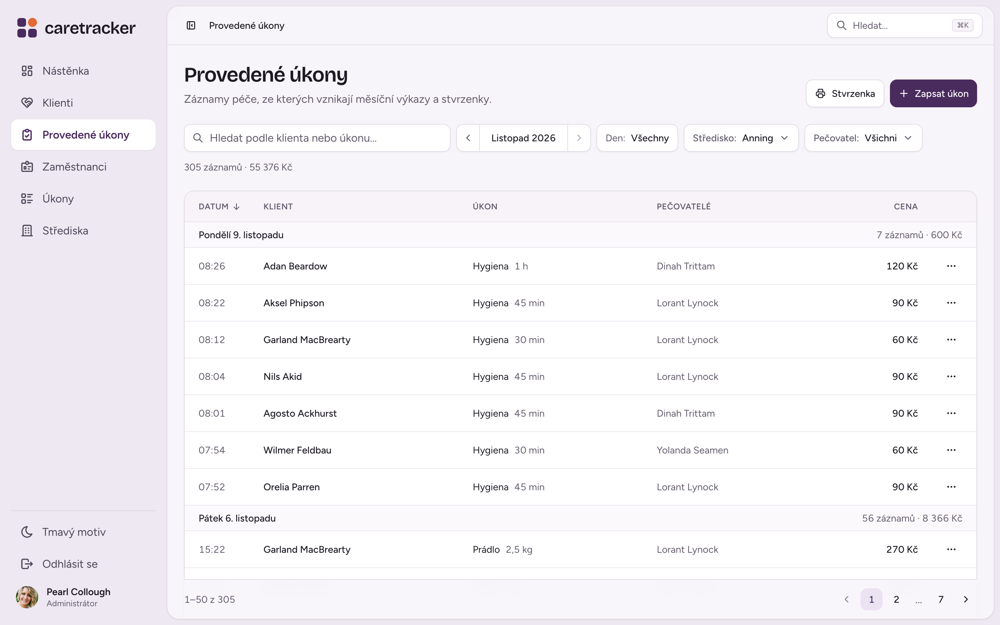
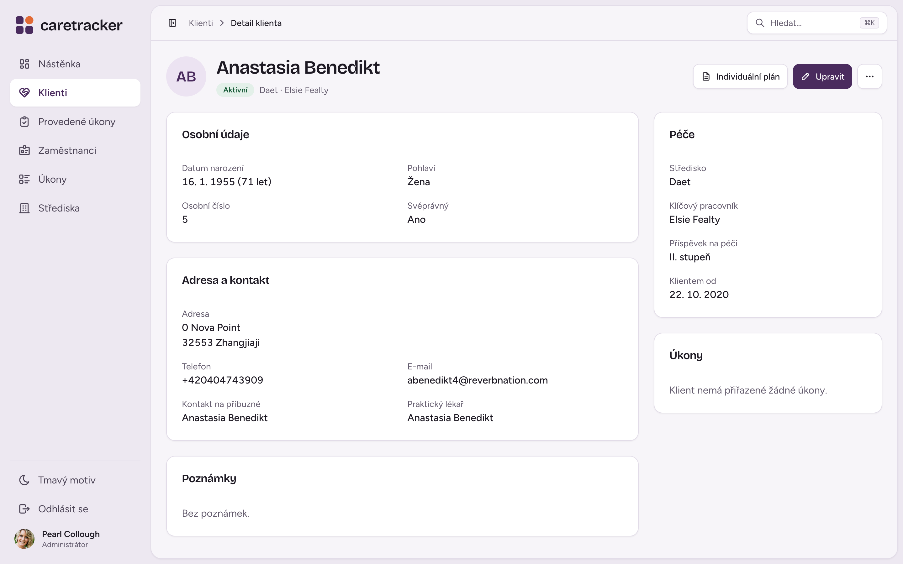
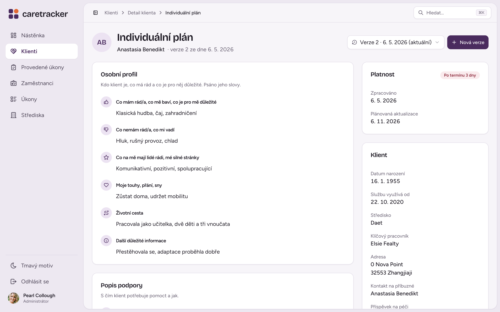
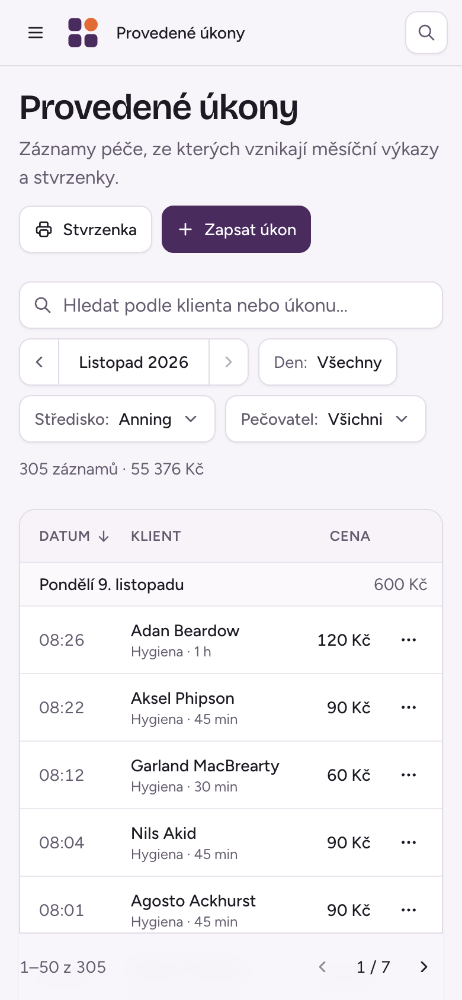

<div align="center">
  <picture>
    <source media="(prefers-color-scheme: dark)" srcset=".github/assets/logo-dark.svg" />
    
  </picture>

  <p><strong>Evidence péče, výkazy a vyúčtování pro pečovatelské služby – na jednom místě, bez papírů.</strong></p>

  <p>
    <a href="https://caretracker.cz"></a>
    <a href="https://demo.caretracker.cz"></a>
  </p>

  <p>
    <a href="https://github.com/michroucka/caretracker/actions/workflows/ci.yml"></a>
    <a href="https://github.com/michroucka/caretracker/actions/workflows/deploy-demo.yml"></a>
    
    
    
    
    
    
    
  </p>

  <p>
    <a href="#funkce">Funkce</a> ·
    <a href="#ukázky">Ukázky</a> ·
    <a href="#rychlý-start">Rychlý start</a> ·
    <a href="#technologie">Technologie</a> ·
    <a href="#dokumentace">Dokumentace</a> ·
    <a href="README.en.md">English</a>
  </p>
</div>

---

CareTracker nahrazuje papírové výkazy a tabulky v terénních pečovatelských službách. Pečovatelé zapisují úkony přímo z mobilu, koordinátoři mají přehled o klientech a vytížení středisek a klienti si sami prohlédnou svůj měsíční výkaz a zaplatí ho přes QR kód. Aplikace vznikla jako bakalářská práce a dál se rozvíjí.

## Funkce

| | |
|---|---|
| **Záznam péče** | Provedené úkony po dnech, s časem, množstvím a cenou. Rychlé zadání, úpravy i hromadný přehled za měsíc. |
| **Klienti** | Osobní údaje, profilová fotka, stupeň příspěvku, přiřazení pečovatelé, ukončení péče a poloha na mapě. |
| **Individuální plány** | Verzované plány péče s denními záznamy pro každého klienta. |
| **Nástěnka** | Měsíční přehled podle role – tržby, vytížení pečovatelů, klienti bez nedávného záznamu a plány k aktualizaci. |
| **Výkazy a stvrzenky** | Měsíční výkazy a stvrzenky v PDF, export dat podle klienta a období. |
| **Vyúčtování pro klienty** | Klient vidí svůj výkaz a platí přes QR kód. |
| **Organizace a střediska** | Více organizací v jedné instalaci (organizace → střediska → zaměstnanci) s odpovídajícím omezením přístupu. |
| **Role a oprávnění** | Superadmin, admin, koordinátor, pečovatel a klient – vynucené na backendu i ve frontendu. |
| **Pro práci v terénu** | Responzivní rozhraní pro mobil, světlý i tmavý režim, rychlé hledání (<kbd>Ctrl</kbd> <kbd>K</kbd> / <kbd>⌘</kbd> <kbd>K</kbd>). |

## Ukázky



<table>
  <tr>
    <td width="50%"></td>
    <td width="50%"></td>
  </tr>
  <tr>
    <td align="center"><sub>Provedené úkony po dnech</sub></td>
    <td align="center"><sub>Detail klienta</sub></td>
  </tr>
  <tr>
    <td width="50%"></td>
    <td width="50%" align="center"></td>
  </tr>
  <tr>
    <td align="center"><sub>Individuální plán</sub></td>
    <td align="center"><sub>Na mobilu</sub></td>
  </tr>
</table>

> Nejrychleji si to vyzkoušíš na [živém demu](https://demo.caretracker.cz).

## Rychlý start

**Potřebuješ:** [Docker](https://www.docker.com/) s Docker Compose a `make` (volitelně, ale zjednodušuje příkazy).

```bash
git clone git@github.com:michroucka/caretracker.git
cd CareTracker

cp .env.example .env
# v .env nastav POSTGRES_USER / POSTGRES_PASSWORD / POSTGRES_DB;
# e-mail, klíč k Mapy.com a klíč pro „Zapamatovat si mě“ patří do
# backend/src/main/resources/secrets.properties (vzor v .env.example)
echo "app.remember-me.key=$(openssl rand -base64 32)" >> backend/src/main/resources/secrets.properties

make up
```

Bez `app.remember-me.key` backend nenastartuje. Na demu ho nastavuje proměnná `REMEMBER_ME_KEY` (vzor v `.env.demo.example`).

| Služba | Adresa |
|---|---|
| Frontend | <http://localhost:3000> |
| Backend API | <http://localhost:8080> |
| PostgreSQL | `localhost:5432` |

<details>
<summary><strong>Užitečné příkazy</strong></summary>

```bash
make down                  # zastavit všechny služby
make restart-backend       # restart backendu
make compile               # rekompilace backendu (DevTools aplikaci sám restartuje)
make rebuild s=backend     # rebuild image + restart služby (po změně Dockerfile)
make clean                 # smazat volumes a vše znovu sestavit (reset databáze)
make logs service=backend  # sledovat logy služby
make seed-activity         # doplnit demo aktivitu až do dneška
make test                  # backendové i frontendové testy
```

Všechny příkazy najdeš v [`Makefile`](Makefile).

</details>

## Technologie

<table>
  <tr>
    <th align="left">Frontend</th>
    <td>
      <a href="https://react.dev/">React 19</a> + <a href="https://vite.dev/">Vite</a>,
      <a href="https://tailwindcss.com/">Tailwind CSS 4</a>,
      <a href="https://ui.shadcn.com/">shadcn/ui</a> nad <a href="https://www.radix-ui.com/">Radix UI</a>,
      <a href="https://reactrouter.com/">React Router</a>,
      <a href="https://recharts.org/">Recharts</a>,
      <a href="https://maplibre.org/">MapLibre</a> s dlaždicemi <a href="https://developer.mapy.com/">Mapy.com</a>,
      <a href="https://motion.dev/">Motion</a>,
      <a href="https://tabler.io/icons">Tabler Icons</a>
    </td>
  </tr>
  <tr>
    <th align="left">Backend</th>
    <td>
      <a href="https://spring.io/projects/spring-boot">Spring Boot 3</a> (Java 21),
      <a href="https://spring.io/projects/spring-security">Spring Security</a> (session),
      <a href="https://spring.io/projects/spring-data-jpa">Spring Data JPA</a>,
      <a href="https://github.com/flyingsaucerproject/flyingsaucer">Flying Saucer</a> (PDF),
      <a href="https://docs.spring.io/spring-framework/reference/integration/email.html">Spring Mail</a> + <a href="https://www.thymeleaf.org/">Thymeleaf</a>
    </td>
  </tr>
  <tr>
    <th align="left">Databáze</th>
    <td><a href="https://www.postgresql.org/">PostgreSQL 15</a>, migrace přes <a href="https://flywaydb.org/">Flyway</a></td>
  </tr>
  <tr>
    <th align="left">Testy</th>
    <td>
      <a href="https://junit.org/">JUnit 5</a>, <a href="https://site.mockito.org/">Mockito</a>,
      Spring Boot Test, Spring Security Test, <a href="https://testcontainers.com/">Testcontainers</a> (PostgreSQL),
      <a href="https://vitest.dev/">Vitest</a>, <a href="https://testing-library.com/">Testing Library</a>, <a href="https://mswjs.io/">MSW</a>
    </td>
  </tr>
  <tr>
    <th align="left">Nasazení</th>
    <td><a href="https://www.docker.com/">Docker Compose</a>, CI (testy, lint, build) na každý PR, demo se nasazuje z <code>main</code> po úspěšném CI</td>
  </tr>
</table>

## Role

```
SUPERADMIN > ADMIN > KOORDINÁTOR > PEČOVATEL
KLIENT (samostatná role, vidí jen vlastní data)
```

Oprávnění hlídá backend (`@PreAuthorize`) i frontend (chráněné trasy a filtry podle role).

## Struktura projektu

```
backend/         Spring Boot – REST API, business logika, migrace databáze
frontend/        React + Vite – uživatelské rozhraní
doc/             bakalářská práce, specifikace, ER a use-case diagramy
docs/branding/   vizuální identita – logo, barvy, typografie, plán redesignu
```

## Dokumentace

- [Bakalářská práce](doc/bachelors_thesis.pdf) – analýza, návrh a uživatelská dokumentace
- [Softwarová specifikace](doc/software_specification.pdf)
- [ER diagram](doc/ERA_Model.pdf) · [Use-case diagram](doc/UC_Diagram.png)
- [Vizuální identita](docs/branding/brand-board.html) a [plán redesignu](docs/branding/PLAN.md)

## Licence

Veškerá práva vyhrazena. Zdrojový kód je zveřejněný k nahlédnutí a pro studijní účely; kopírování, úpravy ani komerční využití bez souhlasu autora nejsou povolené. Viz [`LICENSE`](LICENSE).
